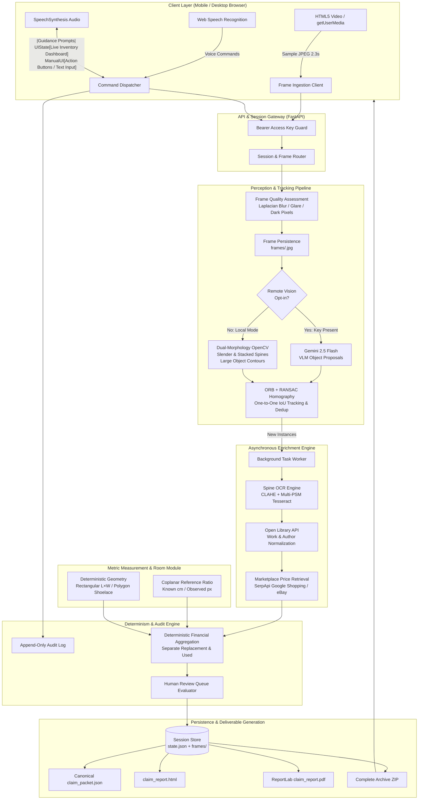

# System Architecture Specification — Library Contents Claim Agent

## 1. Architectural Overview

The **Library Contents Claim Agent** is an evidence-first, modular, privacy-preserving web application designed for on-site or policyholder-conducted home library contents insurance claim intake. It bridges physical scene perception (computer vision, spine OCR, metric geometry) with digital bibliographic verification and live marketplace price retrieval, emitting an audit-grade insurance claim packet.

### Core Architecture Philosophy
1. **Evidence-Anchored:** No object, dimension, or valuation is admitted without an immutable, persistent image frame reference.
2. **Deterministic Financial Math:** AI models propose candidate boundaries and extract raw text; all counting, geometric calculations, currency normalizations, condition thresholds, and financial aggregations are executed by deterministic Python code.
3. **Anti-Hallucination Integrity:** If an object cannot be verified or priced via live listings, its value remains `null` and is routed to a human adjuster review queue rather than being plausibly guessed.
4. **Decoupled Concurrency:** High-speed camera frame ingestion (every ~2.3 seconds) remains responsive on the UI thread while compute-intensive OCR, catalog matching, and external pricing run asynchronously in background tasks.

---

## 2. System Architecture Diagram



---

## 3. Component Responsibilities

### 3.1 Client Layer (`frontend/app.js`, `frontend/index.html`, `styles.css`)
- **Video Capture:** Streams real-time camera video (`facingMode: environment`) and draws snapshots to an offscreen canvas at controlled resolution (~1100px width, JPEG quality 0.78).
- **Voice Guidance & Control:** Synthesizes clear audio pacing prompts and executes continuous, hands-free speech recognition for real-time operator corrections (`"skip that shelf"`, `"first edition"`, `"title is ..."`).
- **Live Inventory Dashboard:** Displays live counts, tabbed views of books, other belongings, and review queues with instantaneous status updates without full page reloads.

### 3.2 API & Session Gateway (`backend/api.py`)
- **Security & Authorization:** Enforces constant-time `secrets.compare_digest` verification for configured `APP_ACCESS_KEY`.
- **Session Lifecycle:** Governs creation (`POST /api/sessions`), live updates, corrections (`POST /api/sessions/{sid}/corrections`), room metadata (`POST /api/sessions/{sid}/room`), and finalization (`POST /api/sessions/{sid}/finish`).
- **Deliverable Serving:** Streams canonical JSON, standalone HTML, downloadable ReportLab PDF, individual evidence JPEGs, and complete ZIP archives.

### 3.3 Perception & Tracking (`backend/vision.py`, `backend/tracker.py`)
- **Frame Quality Assessment:** Computes Laplacian variance for motion blur, white-pixel saturation for glare, and luminance thresholding for under-exposure.
- **Candidate Proposal Generation:**
  - *Local Mode:* Employs dual-kernel morphological closing (vertical and horizontal) on Canny edge maps to detect both upright slender spines and flat/stacked horizontal spines. Detects prominent room objects via contour size heuristics.
  - *Remote Mode:* Invokes Google Gemini 2.5 Flash to generate zero-shot bounding boxes for books and non-book belongings with sanitized JSON parsing.
- **Short-Horizon Geometric Tracking:** Computes ORB keypoint correspondences and RANSAC homography between consecutive frames of the same shelf. Matches bounding boxes using one-to-one Hungarian-style IoU maximization, preventing duplicate inventory entries during smooth camera pans.

### 3.4 Sizing & Geometry (`backend/geometry.py`, `backend/calculations.py`)
- **Spine Sizing:** Calculates metric spine height along the long bounding axis and thickness along the short bounding axis using an established coplanar reference ratio ($cm/px$). Emits uncertainty margins.
- **Room Modeling:** Computes floor area and perimeter wall area for rectangular rooms ($L \times W$, $2H(L+W)$) and irregular rooms via polygon coordinates. Maintains shelved wall area as an independent metric.

### 3.5 Catalogue & Pricing (`backend/catalog.py`, `backend/pricing.py`)
- **Bibliographic Matching:** Submits cleaned title queries to Open Library Search API, normalizing subtitles and returning canonical work titles, authors, and work URLs.
- **Physical Listing Retrieval:** Queries SerpApi for region-local Google Shopping physical products or eBay Browse API. Explicitly rejects digital media (eBooks, Kindle, audiobooks). Separates new retail prices from used pre-owned listings.

### 3.6 Financial Aggregations & Review Queue (`backend/calculations.py`)
- **Deterministic Totals:** Sums only valid, currency-matching prices. Excludes items flagged for appraisal or items with unverified prices.
- **Review Queue Routing:** Automatically routes books with unreadable spines, low title confidence (<75%), uncalibrated metric scale, unverified prices, or high appraisal amounts to the adjuster queue.

### 3.7 Storage & Reporting (`backend/store.py`, `backend/reporting.py`)
- **Atomic Persistence:** Writes session states to temporary files before atomic replacement (`state.tmp -> state.json`).
- **Multi-Format Reporting:** Renders sanitized, XSS-safe HTML reports and professional, multi-page ReportLab PDF reports.

---

## 4. End-to-End Data Flow

```
Camera Frame (JPEG)
  │
  ▼
API /frames -> Quality Filter (Laplacian blur / Glare / Dark)
  │
  ├─ [Unusable] ───────────► Persist to frames/*.jpg + Emit Recapture Warning
  │
  ▼ [Usable]
Detector (Local Contour / Gemini VLM) ──► Candidate Boxes [ymin, xmin, ymax, xmax]
  │
  ▼
ORB + RANSAC Homography Tracker
  ├─ [Matched to Prior Frame] ──► Append Frame Ref to Existing Item (No Duplicate)
  │
  ▼ [New Instance]
Register New Item in State -> Persist frame_ref
  │
  ├──► Synchronous Response (Live counts returned to browser immediately)
  │
  ▼
Asynchronous Background Task:
  1. Crop spine image
  2. Contrast enhancement (CLAHE) + Multi-PSM Tesseract OCR
  3. Query Open Library Work Catalogue
  4. Query Regional Google Shopping / eBay physical listings
  5. Check Appraisal Thresholds (>= 80,000 INR / $1,000 USD)
  6. Atomic State Update (save to state.json)
```

---

## 5. Technology Stack Assessment & Rationale

| Layer / Component | Technology | Rationale & Selection Criteria |
|---|---|---|
| **Backend Framework** | **FastAPI 0.115+** | High-performance asynchronous routing, native Pydantic v2 data validation, OpenAPI specification autogeneration, low memory footprint. |
| **Schema Validation** | **Pydantic v2** | Enforces strict type contracts, cross-field validators (`@model_validator`), and schema sealing (`extra='forbid'`) preventing field pollution. |
| **Server / ASGI** | **Uvicorn (standard)** | Production-grade ASGI server with uvloop event loops, optimal for high-throughput binary frame streaming. |
| **Computer Vision** | **OpenCV (headless) 4.8+** | Fast C++ image manipulation, Laplacian variance calculation, Canny edge detection, morphological filtering, and ORB feature tracking without GUI overhead. |
| **Array Processing** | **NumPy 2.x** | Fast numerical operations for pixel statistics, homography matrix transformations, and bounding box IoU calculations. |
| **Spine OCR** | **pytesseract / Tesseract OCR** | Industry-standard open-source OCR engine running locally without external API costs or privacy leaks. Supported by CLAHE preprocessing. |
| **Multimodal Vision (Opt-In)** | **Google Gemini 2.5 Flash** | Sub-second visual understanding, exceptional dense object localization, structured JSON generation for zero-shot shelf parsing. |
| **Catalog API** | **Open Library Search API** | Free, open bibliographic database for work-level metadata verification, ISBN resolution, and author normalization. |
| **Price Providers** | **SerpApi (Google Shopping) & eBay Browse API** | Live physical merchandise listings with direct product links, seller condition metadata, and regional currency matching. |
| **PDF Generation** | **ReportLab 5.0+** | Deterministic, vector-based PDF document construction with precise pagination, tables, and styling. |
| **Frontend Core** | **Vanilla HTML5, CSS, Modern JS** | Maximum performance, zero bundle size, zero build steps, complete control over WebRTC and Web Speech hardware APIs. |

---

## 6. Architecture Improvements Implemented

1. **Dual-Orientation Spine Detection:** Upgraded the contour detector to process both upright vertical spines and horizontal flat/stacked books.
2. **Offline Non-Book Proposals:** Implemented `local_item_candidates` to detect large furniture, shelving units, and artwork when remote vision is disabled.
3. **Advanced OCR Pipeline:** Integrated CLAHE adaptive contrast enhancement and multi-PSM Tesseract passes (`--psm 6`, `--psm 11`, `--psm 3`) to maximize spine text recovery.
4. **Resilient Regional Currency Parsing:** Replaced brittle startswith symbol checks with robust regex-driven token matching supporting European (`12,50 €`), UK (`£`), and Indian (`₹`, `Rs.`) listing formats.
5. **Real-Time Correction Re-Enrichment:** Engineered `recheck_book` to re-trigger catalog identification and market pricing when an operator verbally corrects a book title.
6. **Irregular Room Geometry:** Added Gauss's Shoelace formula for irregular room floor area and perimeter wall area calculation.
7. **ReportLab PDF Engine:** Built an executive-grade PDF claim packet report generator providing formal paper/PDF deliverable compliance.
