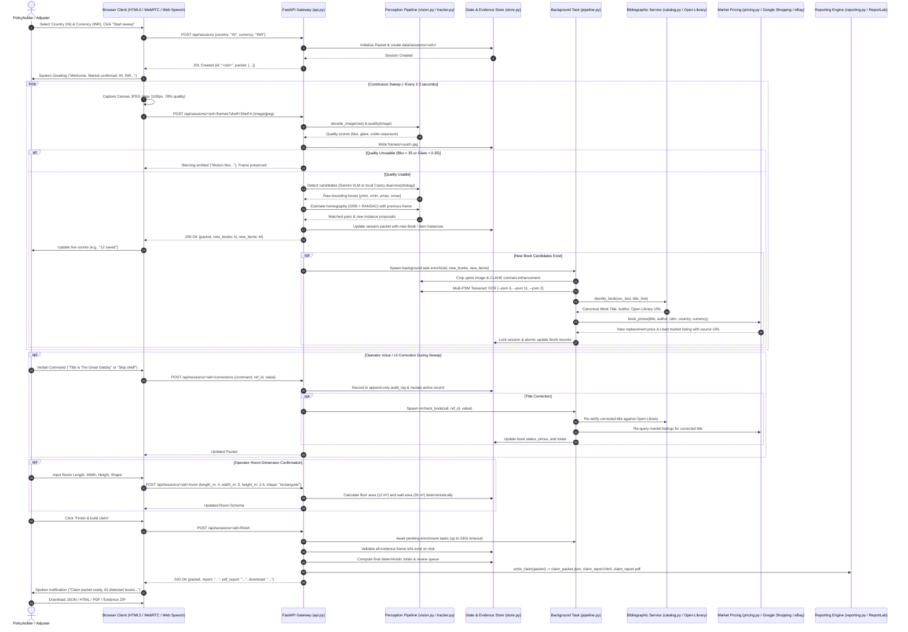

# Data Flow & Lifecycle Specification — Library Contents Claim Agent

## 1. Overview

This document specifies the exact movement, transformation, and validation of data through the Library Contents Claim Agent across its entire lifecycle—from the initial optical capture of bookshelf photons to the generation of the final canonical JSON claim packet and PDF report.

---

## 2. End-to-End Sequence Diagram



---

## 3. Data Schema Transformations by Stage

### Stage 1: Frame Ingestion & Quality Control
- **Input:** Raw binary byte stream (`image/jpeg`, max 4MB).
- **Transformation:**
  - NumPy array decode: `cv2.imdecode(arr, cv2.IMREAD_COLOR)`
  - Aspect downsampling if width/height exceeds 2200px.
  - Laplacian variance: $\text{Var}(\nabla^2 I)$
  - Saturated glare fraction: $\frac{\sum (R > 245 \land G > 245 \land B > 245)}{W \times H}$
  - Dark pixel fraction: $\frac{\sum (I_{\text{gray}} < 25)}{W \times H}$
- **Output:** Frame artifact on disk `data/sessions/<sid>/frames/<uuid>.jpg` and Quality Dict:
  ```json
  {
    "blur_score": 112.45,
    "glare_fraction": 0.021,
    "dark_fraction": 0.045,
    "warnings": [],
    "usable": true
  }
  ```

### Stage 2: Geometric Tracking & Deduplication
- **Input:** Bounding boxes $[y_1, x_1, y_2, x_2]$ in current frame, previous frame keypoints/descriptors.
- **Transformation:**
  - Keypoint matching: ORB detector (1000 features) + BruteForce Hamming distance with Lowe's ratio test ($d_1 < 0.72 \cdot d_2$).
  - Homography estimation: $H \in \mathbb{R}^{3 \times 3}$ using RANSAC (threshold 4.0px).
  - Perspective transformation: $\mathbf{x}' = H \mathbf{x}$.
  - Spatial overlap: Intersection-over-Union ($\text{IoU} > 0.36$) matching one-to-one.
- **Output:**
  - Matched existing items: Frame reference appended to `evidence_refs`.
  - Unmatched new items: Instantiated with UUIDs (`book_<hex>` or `item_<hex>`).

### Stage 3: Spine OCR & Catalogue Verification
- **Input:** Bounding box crop from native frame.
- **Transformation:**
  - CLAHE contrast enhancement: Clip limit 2.0, tile grid $8 \times 8$.
  - Multi-rotation variants: $0^\circ, 90^\circ, 270^\circ$.
  - Tesseract OCR across PSM 6 (uniform block), PSM 11 (sparse text), PSM 3 (auto).
  - Subtitle stripping and normalization: Regex strip non-alphanumeric, split at `:`, `-`.
  - SequenceMatcher title similarity:
    $$\text{score} = \max(\text{sim}(\text{title}_{\text{full}}, q), \text{sim}(\text{title}_{\text{base}}, q))$$
- **Output:** Verified Book metadata:
  ```json
  {
    "title": "The Great Gatsby",
    "author": "F. Scott Fitzgerald",
    "id_confidence": 0.94,
    "status": "identified",
    "notes": ["Verified work: https://openlibrary.org/works/OL468523W"]
  }
  ```

### Stage 4: Physical Marketplace Price Sourcing
- **Input:** Verified Work Title, Author, Target Country, Target Currency.
- **Transformation:**
  - SerpApi Google Shopping / eBay Browse query.
  - Negative title filters: Exclude `"ebook"`, `"kindle"`, `"audiobook"`, `"summary of"`.
  - Condition classification: New retail vs. Used / Pre-owned.
  - Currency symbol validation: Recognizes regional symbols (`₹`, `$`, `£`, `€`) and ISO codes.
  - Valuation confidence calculation.
- **Output:** Price models with traceable HTTPS links:
  ```json
  {
    "replacement_cost": {
      "amount": 299.00,
      "currency": "INR",
      "source": "Amazon India (Google Shopping via SerpApi)",
      "url": "https://www.amazon.in/dp/...",
      "retrieved_at": "2026-10-09T16:20:00Z",
      "condition_assumed": "New or equivalent",
      "match_confidence": 0.70
    }
  }
  ```

### Stage 5: Deterministic Financial Aggregation
- **Input:** Active (non-excluded, non-appraisal) items.
- **Transformation:** Pure Python deterministic arithmetic.
  $$\text{books\_replacement\_cost} = \sum_{b \in B_{\text{active}}, \text{status} \ne \text{needs\_appraisal}} b.\text{replacement\_cost}.\text{amount}$$
  $$\text{books\_used\_value} = \sum_{b \in B_{\text{active}}, \text{status} \ne \text{needs\_appraisal}} b.\text{used\_value}.\text{amount}$$
- **Output:** Canonical `Totals` model in `claim_packet.json`.

---

## 4. State Persistence & Crash Resilience

All session modifications follow an atomic write-replace protocol:
1. Session state is serialized to `state.tmp` via Pydantic: `packet.model_dump_json(indent=2)`.
2. `state.tmp` is flushed and replaced atomically: `tmp.replace(folder / 'state.json')`.
3. In-flight enrichment tasks write per-item updates inside a session-keyed asynchronous re-entrant lock (`asyncio.Lock`), ensuring thread-safe concurrency without database deadlocks.
